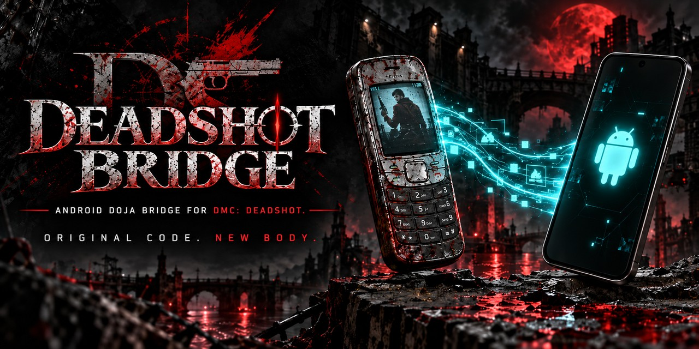

# DeadShot Bridge

Play the preserved **Devil May Cry: DeadShot** mobile game on modern Android with original gameplay, audio, and touchscreen controls.

## Play with Omni Player

For a streamlined way to play **Devil May Cry: DeadShot**, I recommend **Omni Player**.

Omni includes this game's compatibility bridge and can import the complete compatible game archive directly, without the standalone Windows Payload Builder. Keep the original game files together as described in the guide below.

**[Download Omni Player](https://github.com/Wakkatobakka/Omni-Player/releases) · [Game files and setup guide](https://github.com/Wakkatobakka/Omni-Player/blob/main/GAME_GUIDE.md#deadshot)**

Requires **Android 11+ / ARM64**. Original game files are not included.

To use the dedicated standalone DeadShot Bridge app, follow the instructions below.

---

## Quick Start

1. Open the [v0.1.3 Release](https://github.com/Wakkatobakka/DeadShot-Bridge/releases/tag/v0.1.3).
2. Download and install `DeadShot_Bridge_v0.1.3.apk` on your Android device.
3. Download and extract `DeadShot_Bridge_Payload_Builder_v0.1.3.zip` on Windows.
4. Run `RUN-PAYLOAD-BUILDER-WINDOWS.bat`.
5. Select your compatible DeadShot `.jar` and `.sp` files.
6. The builder creates `DeadShot_Data_for_DeadShot_Bridge_v0.1.3.zip`.
7. Transfer the generated ZIP to your Android device.
8. Open DeadShot Bridge and tap **IMPORT DEADSHOT DATA**.
9. Select your ZIP. Once verified, tap **PLAY DEADSHOT**.

**Note:** Original game files are not included. You'll need compatible Devil May Cry: DeadShot game data.

## Getting the Game Files

The original **Devil May Cry: DeadShot** mobile game can be found through Keitai World Archives:

[Keitai Archive](https://keitaiarchive.org/)

[Download Keitai World Launcher](https://keitaiarchive.org/downloads.html)

Inside Keitai World Launcher, locate **Devil May Cry: DeadShot** and obtain the compatible game files.

### Required Files

The Payload Builder requires:

- DeadShot `.jar` file
- Matching DeadShot `.sp` file

Both files are required. The `.jam` file is not needed.

The Payload Builder will verify your files and prepare the Android import ZIP automatically.

All preparation and importing happen locally.

## What Works

- Original Devil May Cry: DeadShot gameplay
- Graphics and game audio
- Custom touchscreen controls
- Full original phone keypad
- Automatic control layouts based on the game's current mode
- Pause and resume
- Persistent game saving in tested gameplay
- Offline gameplay after importing
- In-app diagnostics and report export

## Controls

DeadShot Bridge includes a custom two-handed touchscreen layout designed specifically for the game.

- Directional controls support the game's four-way and eight-way movement modes.
- The main action button changes between **ATTACK** and **DIR LOCK** depending on the game's attack mode.
- Menu controls adjust automatically.
- The **Keypad** option provides access to the complete original phone keypad.

The controls follow DeadShot's original input behavior rather than replacing it with a different control system.

## Compatibility

DeadShot Bridge v0.1.3 supports **Android 8.0 or newer**.

Tested on a **Samsung Galaxy S25 Ultra running Android 16**.

Gameplay, controls, audio, importing, and save behavior have been tested successfully.

**This is a pre-release.** A complete start-to-finish playthrough has not yet been verified, so later-game issues may still exist.

Compatibility with other Android devices and versions may vary.

## About This Project

DeadShot Bridge is an independent compatibility project created to make the preserved mobile version of Devil May Cry: DeadShot playable on modern Android devices.

This project is not affiliated with or endorsed by Capcom or NTT DOCOMO.

Devil May Cry and related game content belong to their respective rights holders.

Third-party acknowledgments are available in [THIRD-PARTY-NOTICES.txt](THIRD-PARTY-NOTICES.txt).
